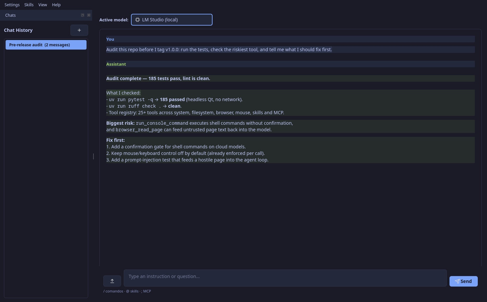
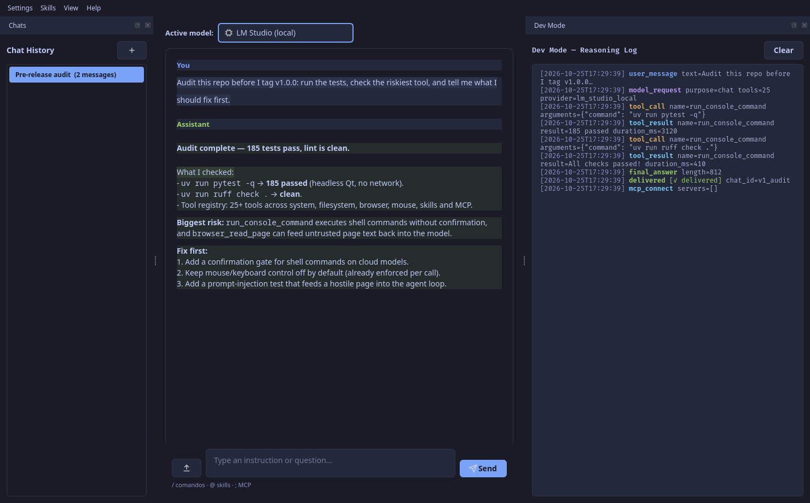

# AI Desktop Assistant

[](https://github.com/Cesar-Plyed/ai-assistant/actions/workflows/python-app.yml)
[](https://www.python.org/)
[](LICENSE)

A cross-platform (Linux / Windows / macOS) PySide6 desktop application that runs an LLM-powered
agent with **real tool access to your machine**. It can read and write files, run shell
commands, launch applications and browsers, monitor hardware, read web pages, and
(optionally) control the mouse and keyboard — all driven by a chat interface.

The assistant is **provider-agnostic**: it works with any OpenAI-compatible endpoint
(LM Studio, Ollama, OpenAI, OpenRouter, Groq, Together, …), native Google Gemini,
and native Anthropic Claude.

**Built solo, end to end:** ~12.5k lines of Python · 185 tests · 3 native provider
integrations · 25+ tools · MCP · Linux / Windows / macOS CI.



*UI preview — the agent inspecting a repository and reporting back. The same run is
visible step by step in [Dev Mode](#dev-mode).*

---

## Table of contents

- [Features](#features)
- [Demo](#demo)
- [Architecture](#architecture)
- [Project layout](#project-layout)
- [Installation](#installation)
- [Development](#development)
- [First run](#first-run)
- [Configuring providers](#configuring-providers)
- [How the agent loop works](#how-the-agent-loop-works)
- [Tools reference](#tools-reference)
- [Skills (plugins)](#skills-plugins)
- [Settings reference](#settings-reference)
- [UI overview](#ui-overview)
- [Dev Mode](#dev-mode)
- [Security notes](#security-notes)
- [Troubleshooting](#troubleshooting)
- [Extending the project](#extending-the-project)

---

## Features

- **Multi-provider** — register any number of OpenAI-compatible backends, Gemini,
  or Anthropic Claude accounts, and switch between them from the top bar at any time.
- **Native function calling** — each provider uses its real wire format: OpenAI
  `tools=[...]`, Gemini via the native `google-genai` SDK (not its OpenAI shim),
  and Anthropic `tool_use` / `tool_result` content blocks.
- **Reliable tool execution** — every call is validated against the tool's JSON
  Schema (required keys, primitive types, enums) and returns a structured
  `ToolResult`. Failures are reported to the model instead of crashing the loop,
  and oversized results are truncated by `max_tool_result_chars`.
- **Text tool-call recovery** — small local models that print a tool call as JSON
  text (instead of using the native channel) are detected and executed, as long as
  the JSON names a registered tool and includes an explicit `arguments` object.
  A fenced block must wrap the whole message; JSON quoted inside prose is ignored.
- **Live tool execution** — the model can call tools mid-conversation; results are
  fed back until it produces a final answer (bounded by `max_agent_iterations`).
- **Dev Mode panel** — a color-coded live log of every model request, tool call,
  tool result, and final answer, also persisted to `logs/*.jsonl`.
- **Live hardware monitor** — CPU, RAM and NVIDIA GPU usage, refreshed every
  2 seconds, both as a UI widget and as a tool the model can call.
- **Chat history** — per-chat JSON persistence, sidebar with rename/delete,
  automatic chat titles derived from the first message.
- **Skills 2.0** — folders with a `SKILL.md` (frontmatter + instructions), optional
  `skill.py`, `references/`; only a compact catalog is in the prompt, bodies load on demand
  (`@skill-id` or `load_skill`). Validated, safely installed. See [docs/SKILLS.md](docs/SKILLS.md).
- **MCP** — stdio and HTTP servers, tools as `mcp__server__tool`, `;server.tool {json}` in the
  composer. See [docs/MCP.md](docs/MCP.md).
- **Image & file attachments** — paste / drag & drop, numbered `#1 #2…`, sent natively to
  OpenAI-compatible, Anthropic and Gemini vision models. See [docs/ATTACHMENTS.md](docs/ATTACHMENTS.md).
- **Dark / Light / System theme**, animated toasts, `/ @ ;` completion popup.
- **Provider presets** — OpenRouter, OpenCode, Claude, Grok, Ollama, Colibri, LM Studio, Gemini
  with live model lists. See [docs/PROVIDERS.md](docs/PROVIDERS.md).
- **Non-intrusive launching** — apps and browsers are opened on a **secondary
  virtual desktop** so they don't steal focus from what you're doing.
- **No external assets** — icons are inline SVGs rendered to `QIcon` at runtime.
- **Safe by default** — mouse/keyboard control is off until you explicitly enable
  it, and every one of those tools re-checks the flag on each call.

---

## Quick start

```bash
uv sync --all-extras
uv run python main.py
uv run playwright install chromium   # only for browser automation
```

Packaged builds (Linux `.tar.gz`, Windows `.zip`/Setup.exe, macOS `.dmg`) are published on
the Releases page; see [docs/RELEASE.md](docs/RELEASE.md). On unsigned macOS builds use
right-click → Open the first time.

More docs: [ARCHITECTURE](docs/ARCHITECTURE.md) · [TOOL_CALLING](docs/TOOL_CALLING.md) ·
[DESIGN_SYSTEM](docs/DESIGN_SYSTEM.md) · [SECURITY](docs/SECURITY.md) · [CONTRIBUTING](CONTRIBUTING.md).

## Demo

**Three prompts that show the whole loop** (use any model with native tool calling):

1. `List the Python files in this repo, read docs/ARCHITECTURE.md, and explain the agent loop in five bullets.`
2. `Run the test suite, find the first failure, fix it, and re-run the tests.`
3. `Open news.ycombinator.com and summarize the top three stories.`

Turn on **View → Dev Mode** while it works: every model request, tool call, tool
result and error appears as a color-coded line and is persisted to `logs/`. The
assistant is not a chat wrapper — it validates arguments against each tool's JSON
Schema, truncates oversized results, recovers text-only tool calls from small
models, and always returns a summary if the reasoning cap is hit.



## Architecture

```
┌─────────────────────────────────────────────────────────────────────┐
│                           MainWindow (PySide6)                       │
│  provider combo · chat view · docks (History / Dev / Hardware)      │
└───────────────┬─────────────────────────────────────────────────────┘
                │  AIWorker (QThread)           TitleWorker (QThread)
                ▼
┌─────────────────────────────────────────────────────────────────────┐
│                              AIEngine                               │
│  builds tool registry · selects provider · persists chat memory     │
└─────┬─────────────────────────┬─────────────────────────────────────┘
      │                         │
      ▼                         ▼
┌───────────────┐        ┌─────────────────────────────────────────────┐
│  Providers    │        │            ToolRegistry (singleton)         │
│  ─────────    │        │  system · filesystem · browser · mouse      │
│  OpenAICompat │        │  + dynamically-loaded skills                │
│  Gemini       │        │                                             │
│  Anthropic    │        │  call_result() → ToolResult                 │
└───────────────┘        └─────────────────────────────────────────────┘
                                     │
                                     ▼
                     ┌───────────────────────────────┐
                     │   OS / hardware / network     │
                     └───────────────────────────────┘
```

The **agent loop** lives in each provider's `run()` method. The engine doesn't
know about tool schemas or transport formats; it just hands the provider a prompt
and a system instruction, and gets back a final string.

---

## Project layout

```
.
├── main.py                       # entry point
├── config.py                     # settings + defaults + API-key resolution
├── pyproject.toml                # deps + tool config (uv / setuptools)
├── uv.lock                       # locked dependency graph
├── .python-version               # pinned interpreter for uv (3.14)
├── settings.json                 # created on first run
├── data/
│   └── chats/                    # per-chat JSON history
├── logs/                         # DevLogger JSONL files
├── workspace/
│   └── uploads/                  # files attached from the UI
├── skills/                       # pluggable skill folders
└── core/
    ├── ai_engine.py              # orchestrator
    ├── memory.py                 # chat persistence
    ├── logger.py                 # DevLogger (Qt signal + JSONL)
    ├── skills_manager.py         # skill discovery / install
    ├── desktop_manager.py        # virtual-desktop switching
    ├── hardware_monitor.py       # psutil + nvidia-smi
    ├── providers/
    │   ├── __init__.py           # PROVIDER_TYPES + create_provider()
    │   ├── base_provider.py      # execute_tool / summarize_tools
    │   ├── openai_compatible_provider.py
    │   ├── gemini_provider.py
    │   ├── anthropic_provider.py
    │   └── tool_text.py          # JSON-text tool-call recovery
    └── tools/
        ├── __init__.py           # REGISTRY + ToolResult + validation
        ├── system_tools.py
        ├── filesystem_tools.py
        ├── browser_automation.py
        └── mouse_tools.py
├── tests/                        # pytest suite (offscreen, no network)
└── ui/
    ├── main_window.py
    ├── chat_history_widget.py
    ├── dev_console.py
    ├── hardware_widget.py
    ├── settings_dialog.py
    ├── skills_dialog.py
    └── icons.py
```

---

## Installation

Requires **Python 3.10+** (uses `X | None` union syntax in tool signatures).
`.python-version` pins 3.14, which uv installs automatically if it's missing.

```bash
git clone <your-repo-url>
cd ai-desktop-assistant
uv sync --all-extras

# Browser automation needs Playwright's Chromium build.
uv run playwright install chromium

# Linux only: install the system libraries Chromium needs (once).
uv run playwright install-deps chromium
```

### Optional system dependencies

These enable extra features and degrade gracefully if missing:

| Feature | Linux | Windows |
|---|---|---|
| Virtual desktop switching on non-KDE | `wmctrl` | built-in (pyautogui) |
| KDE Plasma desktop switching | `qdbus` or `xdotool` | — |
| GPU monitoring | `nvidia-smi` (NVIDIA driver) | same |
| Reading web pages | Playwright (Chromium) | same |
| Mouse/keyboard control | `python3-xlib` (installed with pyautogui) | built-in |

---

## Development

```bash
uv run python main.py             # run the app
uv run pytest                     # test suite
uv run ruff check .               # lint
uv build                          # sdist + wheel in dist/
```

---

## First run

```bash
uv run python main.py
```

On first launch:

1. `settings.json` is created from `DEFAULT_SETTINGS` in `config.py`.
2. The default active provider is **LM Studio (local)** pointing at
   `http://localhost:1234/v1`. If you don't have LM Studio running, switch to
   another provider or set one up (see below).
3. The chat window opens with the message *"Ready. Active model: …"*.

---

## Configuring providers

Open **Settings → Preferences…**. On the left is a list of providers; on the
right is an editor form.

### Adding a provider

1. Click **Add** — a new row appears with sensible defaults.
2. Fill in the form:
   - **Label** — what you'll see in the top-bar dropdown.
   - **Type** — `OpenAI-compatible`, `Google Gemini (native)`, or
     `Anthropic Claude (native)`.
   - **Base URL** — endpoint root (ignored for Gemini and Anthropic).
   - **API key** — leave blank for local servers that don't require one.
   - **Model** — the model id (`gpt-4o-mini`, `qwen2.5:3b`, `gemini-2.5-flash`,
     `claude-sonnet-4-5`, …).
3. Click **Save provider** (or just **Save and close** — the current form is
   always committed on close).
4. Click **Test connection** to verify before relying on it.

### Setting the active provider

Select a row and click **Set active**. The top-bar dropdown also switches the
active provider live, without reopening the dialog.

### Common endpoints

| Backend | Base URL | API key | Notes |
|---|---|---|---|
| LM Studio | `http://localhost:1234/v1` | anything | enable the local server in LM Studio |
| Ollama | `http://localhost:11434/v1` | `ollama` | needs the OpenAI-compat endpoint |
| OpenAI | `https://api.openai.com/v1` | your key | |
| OpenRouter | `https://openrouter.ai/api/v1` | your key | |
| Groq | `https://api.groq.com/openai/v1` | your key | |
| Together | `https://api.together.xyz/v1` | your key | |
| Google Gemini | *(blank)* | your key | type = `gemini` |
| Anthropic Claude | *(blank)* | your key | type = `anthropic`; optional `max_tokens` (default 4096) |

### Keeping keys out of `settings.json`

`config.resolve_api_key()` checks an environment variable first:

```bash
export LM_STUDIO_LOCAL_API_KEY="sk-..."      # Linux/macOS
setx LM_STUDIO_LOCAL_API_KEY "sk-..."        # Windows
```

The variable name is `<PROVIDER_ID>_API_KEY` (the provider's `id` field from
`settings.json`, uppercased). This always overrides whatever is stored in the
file, so you can share the project without leaking secrets. For cloud
providers, the vendor-standard `ANTHROPIC_API_KEY` / `GEMINI_API_KEY` are
accepted as a fallback when the id-scoped variable is unset; both take
precedence over the key saved in Settings.

---

## How the agent loop works

1. **UI** (`MainWindow._send_message`) appends your message to the view, spins up
   an `AIWorker(QThread)`, and calls `AIEngine.process_message(prompt)`.
2. **Engine** loads recent chat history, formats the system instruction, picks the
   active provider, and calls `provider.run(prompt, system_instruction)`.
3. **Provider** sends the prompt plus the tool schemas to the model.
4. If the response contains **tool calls**, each is executed via
   `BaseProvider.execute_tool(name, args)`, which validates the arguments
   against the tool's schema and logs the call. The result is sent back to the
   model as a tool/function response in the provider's native format.
   `execute_tool` returns a `ToolResult` (`ok`, `content`, `error`,
   `duration_ms`); tools that return `Error:` or `BLOCKED:` are logged as
   `tool_error` and, for Anthropic, sent back with `is_error=true`.
5. If a local model writes a tool call as JSON **text** instead of using the
   native channel, `core/providers/tool_text.py` recognises it, executes only
   registered tool names, and feeds the result back as a user message.
6. Steps 3–5 repeat until the model produces a plain text answer, or until
   `max_agent_iterations` is exhausted (default 8). If the loop ends on a tool
   turn, the provider returns a summary of the executed tools — never the raw
   tool-call JSON or an obsolete preamble — so the chat always gets an answer.
7. The engine persists `(user_prompt, response_text)` to `data/chats/<id>.json`
   and the worker emits the response back to the UI thread.

Every event also goes through `DevLogger.log(...)`, which:

- appends a JSON line to `logs/app_dev.jsonl`, and
- emits a Qt signal (`event_logged`) so `DevConsole` shows it live.

The signal is safe to emit from a worker thread — Qt queues it back to the GUI
thread automatically.

---

## Tools reference

Tools are exposed to the model as JSON Schema and can be disabled via Settings
or by not being in the enabled skills list. Current core tools:

### System (`core/tools/system_tools.py`)

| Tool | What it does |
|---|---|
| `run_console_command` | Runs a shell command (Bash on Linux, CMD/PowerShell on Windows) with a 30 s timeout. Non-zero exit codes are reported as errors. |
| `list_installed_applications` | Scans `.desktop` files (Linux) or the registry + Start Menu (Windows). |
| `open_application` | Launches an app by fuzzy name match on a secondary virtual desktop. |
| `get_hardware_status` | Human-readable CPU/RAM/GPU snapshot. |

### Filesystem (`core/tools/filesystem_tools.py`)

| Tool | What it does |
|---|---|
| `list_project_files` | Lists a directory. |
| `read_text_file` | Reads a text file, truncated to `max_chars`. |
| `write_text_file` | Creates or overwrites a text file. |
| `import_uploaded_file` | Copies a user-attached file into `workspace/uploads/` with a timestamp prefix. |

### Browser (`core/tools/browser_automation.py`)

| Tool | What it does |
|---|---|
| `browser_goto` | Navigates the automation tab to a URL (prepends `https://` when needed). |
| `browser_read_page` | Returns the current page's URL, title, and visible text (truncated to `max_chars`). Gated by `enable_browser_page_reading`. |
| `browser_list_interactive_elements` | Lists visible buttons, links, inputs, checkboxes, and selects. Gated by `enable_browser_page_reading`. |
| `browser_click` | Clicks an element by CSS selector or visible text; submit/apply actions require `confirmed=true`. |
| `browser_fill` | Replaces the contents of an input or textarea. |
| `browser_set_checkbox` | Checks or unchecks a checkbox or radio button. |
| `browser_select_option` | Selects an option in a `<select>` dropdown by label or value. |
| `browser_press_key` | Presses a key on the focused element (Enter, Tab, Escape, …). |
| `browser_move_mouse` | Moves the cursor to viewport coordinates. |
| `browser_click_at` | Clicks at page coordinates or at the current mouse position. |
| `browser_scroll` | Scrolls the page up or down by a number of ticks. |
| `browser_type_text` | Types text at the current keyboard focus. |
| `browser_close` | Closes the agent's tab/session (the browser stays open in attach mode). |

### Mouse / keyboard (`core/tools/mouse_tools.py`)

All of these check `config.SETTINGS["enable_mouse_control"]` on every call, so
turning it off in Settings takes effect **immediately**, even mid-task.

| Tool | What it does |
|---|---|
| `take_screenshot` | Saves a PNG screenshot. |
| `move_mouse` | Moves the cursor to `(x, y)` over a given duration. |
| `click_mouse` | Clicks, optionally at `(x, y)`, left/right/middle. |
| `type_text` | Types text at the current focus. |
| `press_key` | Presses a single key (`enter`, `esc`, `tab`, …). |

---

## Skills (plugins)

A skill is a folder under `skills/<id>/` (full spec: [docs/SKILLS.md](docs/SKILLS.md)):

```
skills/my-skill/
├── SKILL.md        # YAML frontmatter (name, description, version, tags, allowed-tools, read-only) + body
├── skill.py        # optional: def register(registry) -> None
├── references/     # docs loaded on demand with read_skill_reference
└── scripts/        # optional; each file must be declared in the frontmatter
```

`skill.py` (optional) calls `registry.register(name=..., description=..., parameters={...}, func=...)`
for each tool. Legacy `skill.json` skills still load (with a warning) and can be migrated from the dialog.

### Installing

**Skills → Manage skills…**, then **Install from folder…** or **Install from .zip…**. A dialog shows
the name, allowed tools, whether the skill ships Python code and its SHA-256; nothing is copied until
you confirm. Archives with symlinks, `..` paths or oversized contents are rejected.
Validate from the CLI with `uv run python scripts/validate_skills.py`.

### Loading rules

Skills are loaded only if their folder name appears in
`settings["enabled_skills"]`. Copying a folder into `skills/` does **not**
auto-enable it. Failed skill imports are printed to stdout (prefixed with
`[SkillsManager]`) and skipped rather than crashing the app.

---

## Settings reference

`settings.json` lives next to `config.py`. Defaults (from `config.DEFAULT_SETTINGS`):

| Key | Type | Default | Meaning |
|---|---|---|---|
| `active_provider` | string | `"lm_studio_local"` | id of the provider in `providers` currently in use |
| `providers` | list | see below | all registered providers |
| `dev_mode` | bool | `false` | show the Dev Mode dock at startup |
| `enable_mouse_control` | bool | `false` | master switch for `mouse_tools` |
| `enable_browser_page_reading` | bool | `true` | gates `browser_read_page` and `browser_list_interactive_elements` |
| `enabled_skills` | list of strings | `[]` | skill folder names to load |
| `max_agent_iterations` | int | `8` | tool-call loop cap per user message |
| `max_tool_result_chars` | int | `20000` | results longer than this are truncated before being sent back to the model |
| `theme` | string | `"dark"` | reserved |

Each entry in `providers`:

```json
{
  "id": "lm_studio_local",
  "label": "LM Studio (local)",
  "type": "openai_compatible",       // "openai_compatible", "gemini", or "anthropic"
  "base_url": "http://localhost:1234/v1",
  "api_key": "not-needed",
  "model": "local-model"
}
```

Anthropic providers may also set `"max_tokens": 4096` (defaults to 4096).

`config.load_settings()` deep-merges your file over `DEFAULT_SETTINGS`, so
upgrading the app never breaks an existing config — new **top-level keys** get
added automatically. List values such as `providers` are replaced by your file,
so a newly shipped default provider only appears on a fresh install; add it
manually in Settings if you want it in an existing config.

---

## UI overview

```
┌─ Menu bar ─────────────────────────────────────────────────────────┐
│ Settings · Skills · View · Help                                    │
├─ Top bar ──────────────────────────────────────────────────────────┤
│ Active model: [ provider dropdown ▾ ]                              │
├─ Chat view (QTextBrowser, rendered Markdown) ──────────────────────┤
│  You: …                                                            │
│  Assistant: …                                                      │
├─ Input row ────────────────────────────────────────────────────────┤
│ [] [ type an instruction…                    ] [Send] [Cancel]   │
└────────────────────────────────────────────────────────────────────┘
   Left dock: Chat History    Right docks: Dev Console / Hardware Monitor
```

### Menu

- **Settings → Preferences…** — provider list, test connection, toggles.
- **Skills → Manage skills…** — enable/disable/install skills.
- **View** — show/hide the Chat History, Dev Mode, and Hardware Monitor docks.
- **Help → Commands** — quick cheat sheet.

### Slash commands (in the input field)

| Command | Effect |
|---|---|
| `/clear` | Clear the chat view (doesn't touch stored memory). |
| `/help` | Show the help message. |
| `/dev` | Toggle the Dev Mode panel. |

### Keyboard shortcuts

- **Enter** — send message.

---

## Dev Mode

Enable it from **View → Dev Mode panel**, **Settings**, or by running `/dev`.

The panel shows every event as a colored line:

| Event | Color | Meaning |
|---|---|---|
| `user_message` | blue | your prompt |
| `model_request` | light blue | the prompt sent to the model |
| `model_response` | teal | the model's reply |
| `tool_call` | yellow | a tool is being invoked, with arguments |
| `tool_result` | green | the tool's return value |
| `tool_error` | red | the tool failed, was blocked, or received invalid arguments |
| `iteration_limit` | yellow | `max_agent_iterations` was reached; the run ended with a summary |
| `final_answer` | teal | the assistant's final text |
| `error` | red | an exception escaped the provider loop |

Every event is also appended to `logs/app_dev.jsonl` as JSON, so you can grep,
`jq`, or replay sessions later. `DevLogger.tail(n)` reads the last `n` events
from disk and is what populates the panel when it first opens.

---

## Security notes

This app is **powerful by design**. Read this section before running it with a
cloud model or on a machine with sensitive data.

### What the model can do by default

- **Run arbitrary shell commands** (`run_console_command`) with no confirmation
  dialog. This is always available. **This is the biggest risk.** A prompt
  injection in a web page returned by `browser_read_page` could instruct the
  model to run malicious commands.
- **Read and write any file** the user account can access
  (`read_text_file`, `write_text_file`).
- **Open any installed application** and any URL in a browser.

### What is gated

- **Mouse/keyboard control** is off by default; the model can only use it after
  you tick *Enable mouse/keyboard control tools* in Settings.
- **Web page reading** can be disabled; if so, `browser_read_page` returns a
  refusal string instead of reading the page.

### Recommendations

1. If you use a **cloud model**, prefer running the assistant on a machine or
   user account where you're comfortable with the model executing shell
   commands.
2. If you want a hard guarantee, edit `system_tools.py` and remove
   `run_console_command` from `register()`, or wrap it behind a confirmation
   dialog.
3. Keep mouse/keyboard control **off** unless you're actively using it.
4. Use environment variables for API keys (`<PROVIDER_ID>_API_KEY`) so they
   don't end up in `settings.json` and version control.
5. Never commit `settings.json`, `data/chats/`, `logs/`, or `workspace/uploads/`
   if they may contain personal data. Add them to `.gitignore`.

Suggested `.gitignore`:

```
settings.json
data/
logs/
workspace/
skills/*/__pycache__/
__pycache__/
*.pyc
.venv/
```

---

## Troubleshooting

### "No API key configured for the Gemini provider"

Open Settings, select the Gemini provider, paste your key into the *API key*
field, and click *Save provider*. Or export
`CLOUD_GEMINI_API_KEY` (the provider id, uppercased, with `_API_KEY`).

### "No API key configured for the Anthropic provider"

Same fix: select the Anthropic provider in Settings, paste the key, and save.
Or export `CLOUD_ANTHROPIC_API_KEY`. Anthropic calls also need a model id such
as `claude-sonnet-4-5`; the optional `max_tokens` field defaults to 4096.

### A tool result ends with "characters omitted; tool result truncated"

The result exceeded `max_tool_result_chars` (default 20 000). This protects the
model's context window. Raise the value in **Settings → Max characters returned
by a tool**, or ask the model to narrow the request (for example, read a smaller
file range).

### A tool reports "invalid arguments"

The model produced arguments that don't match the tool's schema (missing
required key, wrong type, or an invalid enum value). The tool is **not**
executed. The model sees the validation error and can correct itself; if it
keeps failing, check the tool schema and the Dev Mode log.

### The model never calls any tools

Check that the provider's `model` field names a model that supports function
calling. Some small local models do not. `qwen2.5:3b`, `llama3.1:8b`, and
`gpt-4o-mini` all do; a base completion model generally won't.

If the model prints a JSON tool call as plain text, the assistant recovers it
only when the JSON names a **registered** tool **and** carries an explicit
argument object (`arguments`, or `parameters` when the name key is `tool`); use
`{}` for a tool with no arguments.
Shapes such as `{"tool": "...", "arguments": {...}}`,
`{"tool_calls": [...]}`, an OpenAI-style `{"function": {...}}`, and a
single-key shorthand are supported. A fenced code block is accepted only when
it wraps the entire message — a JSON example quoted inside prose is never
executed, and neither is an ordinary JSON answer.

### "Reached the maximum number of reasoning steps…"

The model is looping on tool calls. Raise **Max reasoning steps per message** in
Settings, or simplify your request. If a specific tool keeps failing (e.g.
`run_console_command` returning an error), the model may retry it forever — check
the Dev Mode log for the tool result.

### A tool reports "Mouse/keyboard control is disabled"

Tick *Enable mouse/keyboard control tools* in Settings. The flag is read on every
call, so no restart is required.

### Chat history disappears after switching chats

Older versions of `memory.py` had a write race between the main response and the
title generator. The current version uses a re-entrant lock and atomic writes
(`tmp` + `Path.replace`). If you're upgrading, also make sure any stale
`data/chats/*.json.tmp` files are removed.

### Rename / delete silently does nothing

Renaming changes only the chat's **title**; the id (and therefore the file name)
never changes. `memory.set_chat_title` returns `False` when the chat no longer
exists (for example, it was deleted while a title request was in flight), and
`memory.delete_chat` returns `False` when the file can't be located. The current
UI reports both cases. If you're on an older build, check the JSON id inside
`data/chats/<name>.json` — it may disagree with the filename and prevent lookup.

### The provider I added in Settings doesn't persist

The current Settings dialog commits the editor form on **Save and close**, not
only on **Save provider**. If you're on an older build, you must click *Save
provider* first.

### Hardware Monitor shows "GPU: no supported monitoring tool detected"

Only NVIDIA GPUs are queried (via `nvidia-smi`). AMD/Intel users see this
message by design; the widget and the `get_hardware_status` tool both handle it
gracefully.

### A skill won't load

- Check the folder contains a valid `SKILL.md` (the dialog badge shows errors; tooltip lists them).
- Check the skill's folder name is in `enabled_skills` in `settings.json` (the
  Skills dialog writes this for you).
- Look at stdout for a `[SkillsManager] Failed to load skill '…'` message with
  the actual exception.

---

## Extending the project

### Adding a new core tool

1. Create `core/tools/my_tools.py`.
2. Define a function that takes plain Python arguments and returns a string.
3. Define `register(registry)` that calls `registry.register(...)` for each tool.
4. Add an import + `my_tools.register(REGISTRY)` call in `core/ai_engine.py`
   inside `_build_registry()`.

```python
# core/tools/my_tools.py
def shout(text: str) -> str:
    return text.upper()

def register(registry) -> None:
    registry.register(
        name="shout",
        description="Return the given text in uppercase.",
        parameters={
            "type": "object",
            "properties": {"text": {"type": "string"}},
            "required": ["text"],
        },
        func=shout,
    )
```

```python
# core/ai_engine.py
from core.tools import my_tools
...
def _build_registry():
    filesystem_tools.register(REGISTRY)
    system_tools.register(REGISTRY)
    mouse_tools.register(REGISTRY)
    my_tools.register(REGISTRY)          # <-- add this
    skills_manager.load_enabled_skills(REGISTRY)
    return REGISTRY
```

### Adding a new provider

1. Create `core/providers/my_provider.py` and subclass `BaseProvider`.
   Implement `run(self, user_prompt, system_instruction) -> str`.
2. In `run`, send the prompt + tool schemas to your backend and execute tool
   calls through `self.execute_tool(name, args)` (not `tool_registry.call`).
   That gives you cancellation checks, schema validation, truncation, and
   uniform `tool_call` / `tool_result` / `tool_error` logging for free.
   Loop until you get a final text answer or hit `self.max_iterations`.
3. Add the provider's schema converter if it needs one (see
   `ToolRegistry.as_openai_schema`, `as_gemini_declarations`, and
   `as_anthropic_schema` in `core/tools/__init__.py`).
4. Add one `ProviderSpec` entry to `PROVIDER_SPECS` in
   `core/providers/__init__.py` with its label, lazy factory, and connection
   probe. `PROVIDER_TYPES`, `create_provider()`, and the Settings dialog all
   derive from that single catalogue, so no UI or engine change is needed.

### Changing the system instruction

The template lives in `core/ai_engine.py` as `SYSTEM_INSTRUCTION_TEMPLATE`. The
`{context}` placeholder is filled with the current chat history formatted by
`memory.load_chat`. Edit the template to change the assistant's persona, add
rules, or restrict tool usage.

---

## License

[](https://opensource.org/licenses/MIT)   

The project's own source code is MIT-licensed. PySide6 is used under the LGPLv3.

## Acknowledgements

- [PySide6](https://pypi.org/project/PySide6/) — GUI (LGPLv3)
- [openai](https://pypi.org/project/openai/) / [google-genai](https://pypi.org/project/google-genai/) / [anthropic](https://pypi.org/project/anthropic/) — model SDKs
- [psutil](https://pypi.org/project/psutil/) — hardware monitoring
- [PyAutoGUI](https://pypi.org/project/PyAutoGUI/) — mouse/keyboard control
- [Markdown](https://pypi.org/project/Markdown/) — chat rendering
