# Architecture

The assistant is a single-process PySide6 desktop application. A Qt window owns
the conversation, while every model request runs on a worker thread. The
`AIEngine` is the only orchestrator: it assembles context, picks the active
provider, runs one turn, and persists the result. Providers own the agent loop;
tools are shared through one registry, so a new tool is available to every
backend without provider changes.

## Design principles

| Principle | Consequence in the code |
|---|---|
| The engine is provider-agnostic | `AIEngine` never imports a transport SDK or a tool schema; it calls `create_provider(...).run(...)`. |
| One tool definition, three wire formats | `core/tools/__init__.py::ToolRegistry` exposes `as_openai_schema()`, `as_anthropic_schema()` and `as_gemini_declarations()`. |
| The GUI thread never blocks | `AIWorker`, `TitleWorker` and `MCPConnectWorker` are `QThread`s; `DevLogger` crosses back through queued Qt signals. |
| Settings are data, not code | `config.DEFAULT_SETTINGS` is deep-merged with `settings.json`; environment variables override API keys. |
| Context is loaded progressively | Skills ship a compact catalog; bodies load on `@skill` or `load_skill`. Attachments send a text manifest and only the current turn's pixels. |
| Persistence is metadata-first | Chats store attachment paths/hashes, never base64; model-ready images are regenerated from disk. |

---

## 1. System context

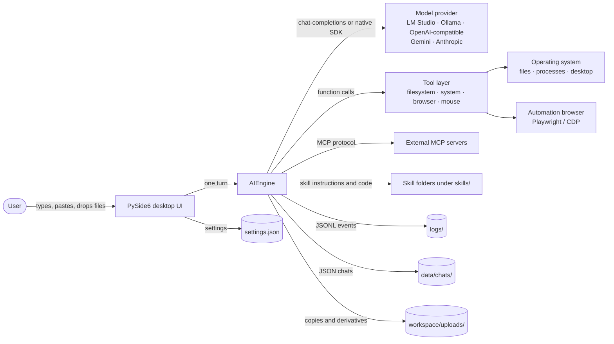

---

## 2. Layered architecture

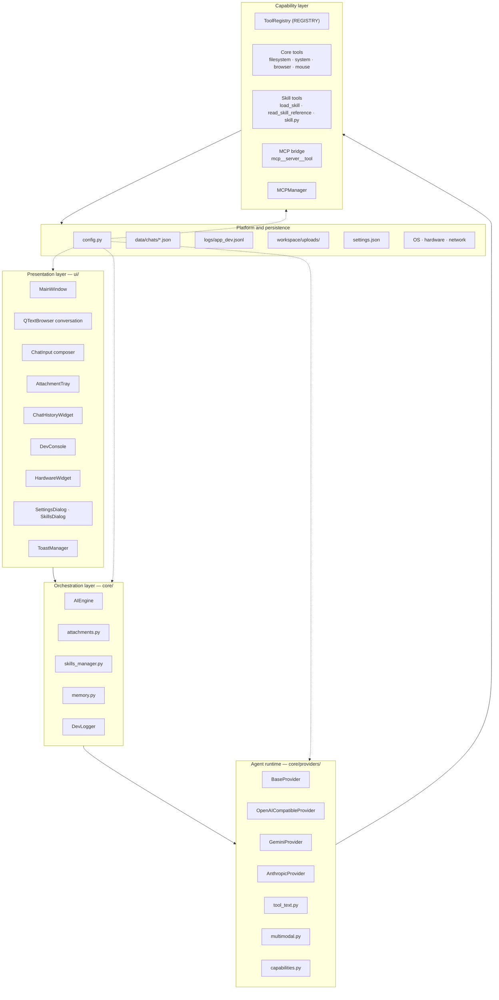

Dependency rule: arrows point downward. `ui/` may import `core/`; `core/` never
imports `ui/`. `config.py` is imported by every layer and imports nothing from
the application. Provider SDKs (`openai`, `anthropic`, `google-genai`) are
imported lazily, so selecting one backend does not load the others.

---

## 3. Module map

| Area | Modules | Responsibility |
|---|---|---|
| Entry point | `main.py`, `config.py` | Create the `QApplication`, apply the theme, open `MainWindow`; own settings and base directories. |
| Engine | `core/ai_engine.py` | Build the registry, system prompt, skill/MCP context and attachment manifest; run one turn; persist it. |
| Providers | `core/providers/__init__.py`, `base_provider.py`, `openai_compatible_provider.py`, `gemini_provider.py`, `anthropic_provider.py` | Factory, shared tool execution/logging, and the per-provider agent loop. |
| Provider helpers | `capabilities.py`, `presets.py`, `model_catalog.py`, `multimodal.py`, `tool_text.py` | Vision/tool heuristics, settings presets, live model lists, multimodal payloads, JSON-text tool-call recovery. |
| Tools | `core/tools/__init__.py` (`REGISTRY`, `ToolResult`), `effects.py`, `filesystem_tools.py`, `system_tools.py`, `browser_automation.py`, `mouse_tools.py` | Tool schemas, validation, truncation, execution, toast metadata. |
| MCP | `core/mcp/manager.py`, `registry.py`, `mentions.py` | Async sessions in a daemon thread, registry bridge, `;server.tool` mentions. |
| Skills | `core/skills_manager.py`, `skills/<id>/` | Discovery, validation, progressive disclosure, safe install, legacy migration. |
| Attachments | `core/attachments.py`, `ui/attachment_tray.py` | Validation, storage, thumbnails, model derivatives, chat metadata. |
| Memory | `core/memory.py` | Atomic chat JSON persistence and titles. |
| Logging | `core/logger.py` | JSONL event log plus the `event_logged` Qt signal for Dev Mode. |
| Platform | `core/hardware_monitor.py`, `core/desktop_manager.py` | CPU/RAM/GPU snapshots and virtual-desktop switching. |
| UI | `ui/` | Windows, docks, composer, completion popup, toasts, theme, icons. |
| Packaging | `scripts/build.py`, `scripts/validate_skills.py`, `packaging/` | PyInstaller bundles, skill validation, installers. |

---

## 4. Class diagram

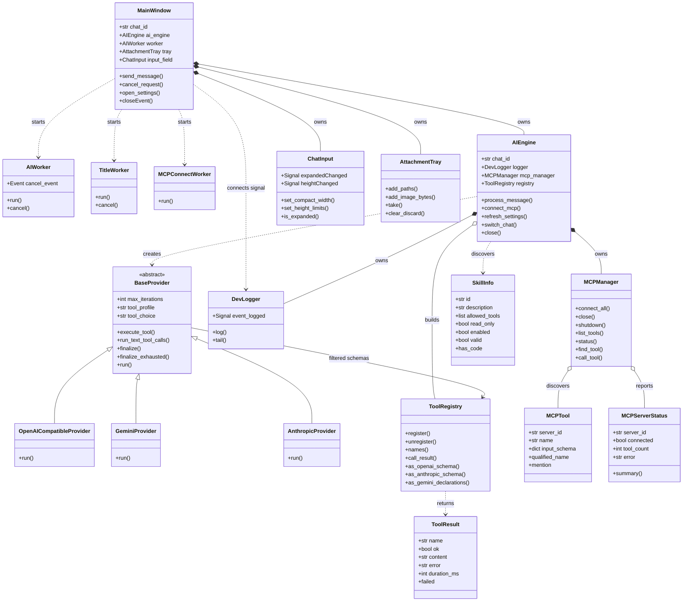

---

## 5. End-to-end message flow

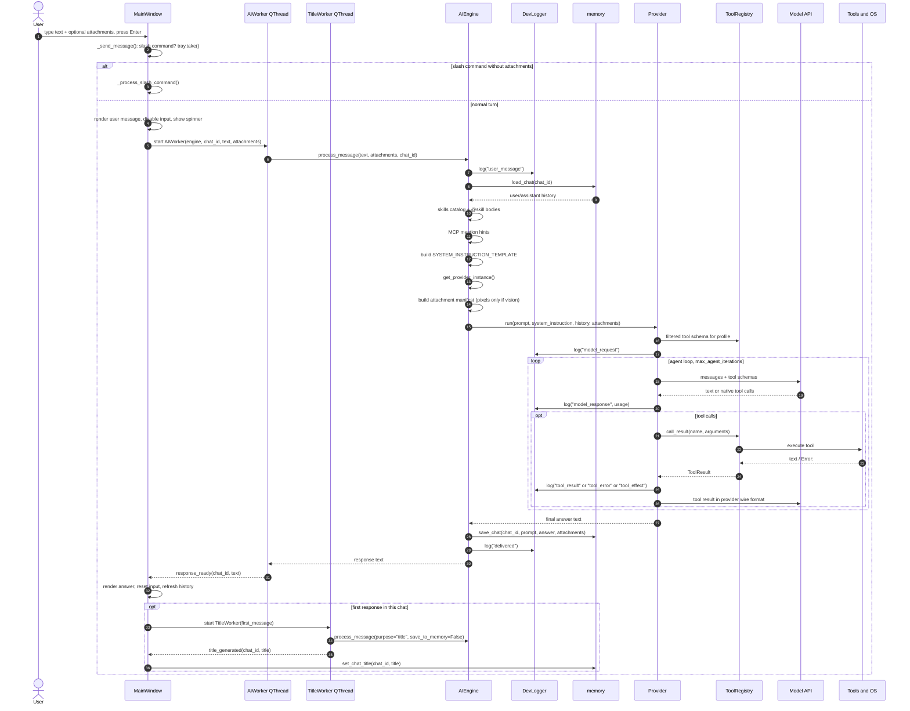

Cancellation is cooperative: `AIWorker.cancel()` sets a `threading.Event`;
providers call `_check_cancelled()` at each loop boundary and raise
`RequestCancelled`. The UI is restored in `_on_worker_finished`, never by
joining the thread from the click handler.

---

## 6. Agent loop and tool execution

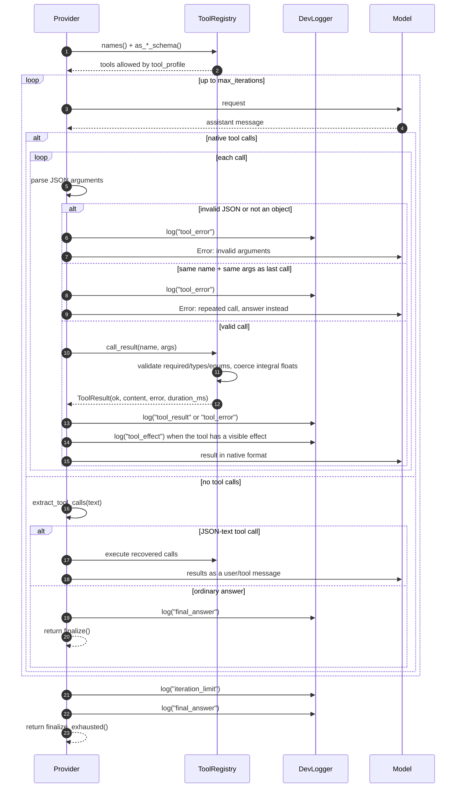

Tool results are truncated to `max_tool_result_chars` (default 20 000) with an
explicit `[... N characters omitted ...]` marker. A tool that returns `Error:`
or `BLOCKED:` counts as failed even when it did not raise, so Dev Mode and
Anthropic's `is_error` flag agree.

### Tool profiles

| Profile | Groups exposed | Typical use |
|---|---|---|
| `full` | filesystem, browser, system, mouse, skills, MCP | Capable models on a trusted machine. |
| `compact` (default) | filesystem, browser, system, skills, MCP | Small local models; keeps the schema list short. |
| `read-only` | `list_project_files`, `read_text_file`, `load_skill`, `read_skill_reference`, `browser_read_page`, `browser_list_interactive_elements`, `get_hardware_status`, plus `allowed-tools` of enabled read-only skills | Inspection without side effects. MCP tools are excluded. |

`tool_choice` maps to `auto` / `required` / `none` on OpenAI-compatible
backends and to `auto` / `any` / `none` on Anthropic. `parallel_tool_calls` is
accepted by the provider constructors; Gemini and Anthropic collect every call
of a turn before sending the result block.

---

## 7. MCP lifecycle

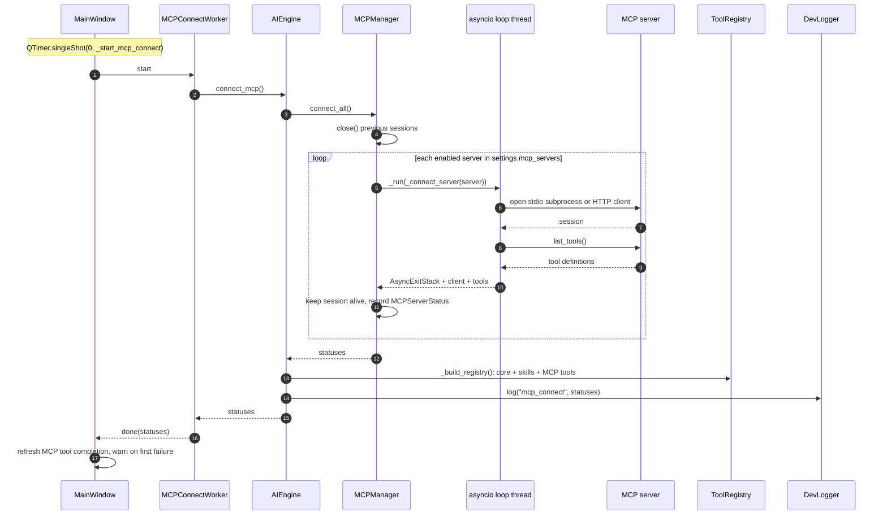

Each server keeps one `AsyncExitStack` open for the whole app session; closing a
stdio session kills its subprocess, so `close()` is only used when reconnecting
or shutting down. `MCPManager.call_tool` runs the coroutine on the loop thread
with `mcp_call_timeout` (default 60 s), flattens the result to text, and turns
timeouts and exceptions into `Error: ...` strings the model can read.

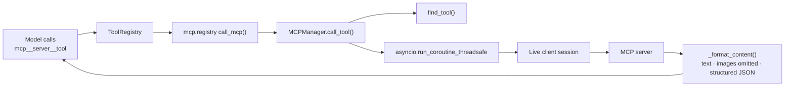

User mentions are parsed by `core/mcp/mentions.py`. `;server.tool` (optionally
followed by a JSON object) adds a hint to the system prompt; it does not execute
the tool directly. The model still makes the actual call through the registry.

---

## 8. Skills: discovery, activation, installation

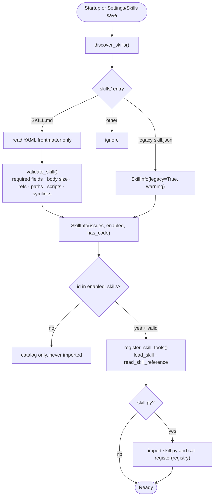

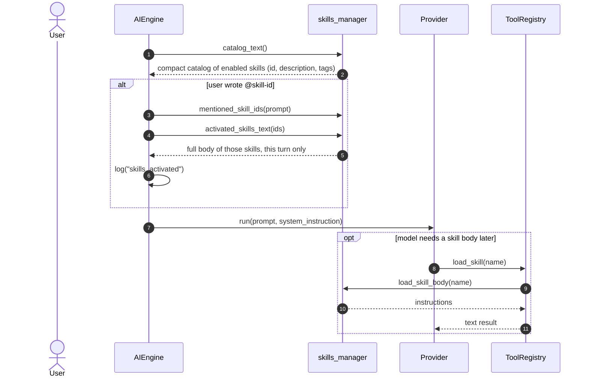

Skill bodies are never embedded in the chat history: the catalog is rebuilt
from settings on every turn, and `@skill` activation lasts one request.
`skill.py` is imported only for enabled, valid skills that ship code; import
failures print `[SkillsManager] ...` and are skipped.

Installation is a separate, confirmation-gated path:

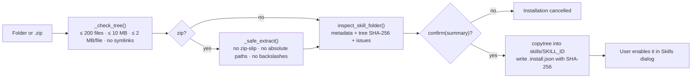

---

## 9. Attachments pipeline

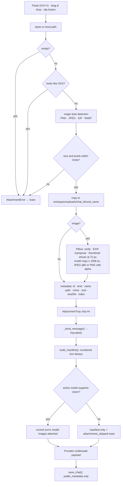

Limits: 10 attachments, 20 MB per image, 50 MB per other file, 50 MP, no SVG,
no animated GIF/WebP. Reordering renumbers `index` 1..n; older turns keep their
manifest text but their pixels are not re-sent.

---

## 10. Chat persistence and switching

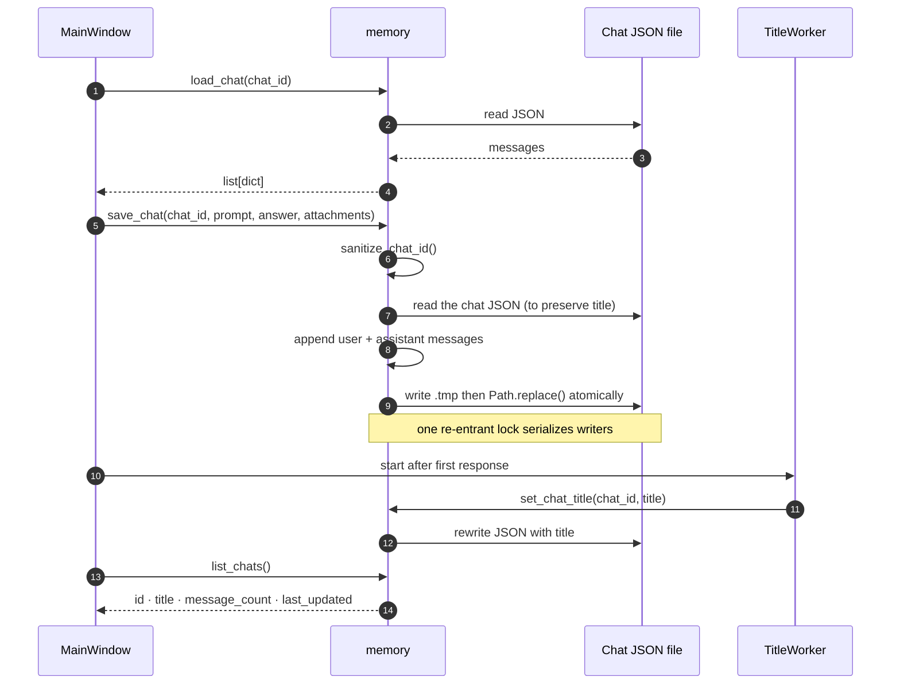

Chat ids are sanitized to a safe filename; titles live inside the JSON (not in
the filename) and survive `save_chat`. `AIEngine.switch_chat()` changes only the
chat id, keeping the registry and the Dev Logger connection alive. A turn binds
its chat id once, so switching windows mid-request cannot redirect the answer.

---

## 11. UI threading model

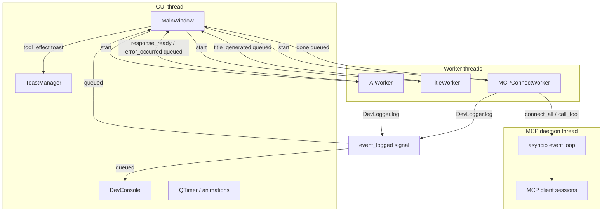

Rules:

- Never destroy a running `QThread`: `closeEvent` cancels and waits for every
  worker, and title workers are kept in a set until `finished`.
- `DevLogger.log()` is safe from any thread; Qt queues `event_logged` to the GUI
  thread.
- The MCP manager refuses calls made from its own loop thread, preventing
  deadlocks.
- Long operations (model call, MCP startup) never run on the GUI thread.

### Composer state machine

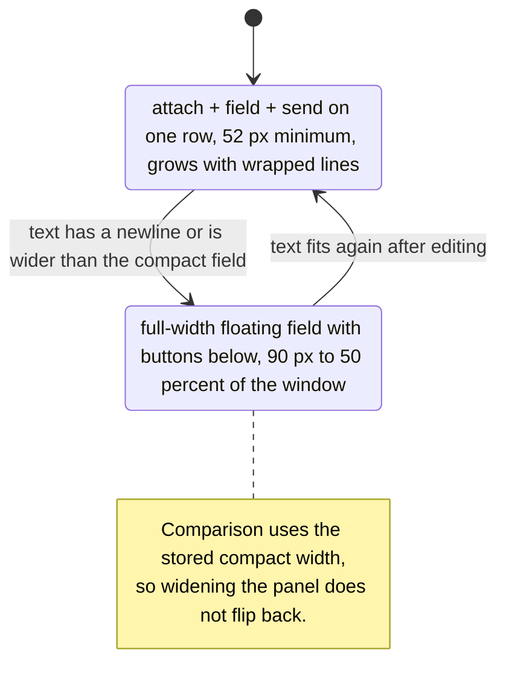

The composer floats over the conversation: `MainWindow` reserves bottom
viewport margins instead of shrinking the chat. `ChatInput.heightChanged`
drives the clearance, and `expandedChanged` swaps the grid layout.

---

## 12. Deployment and data locations

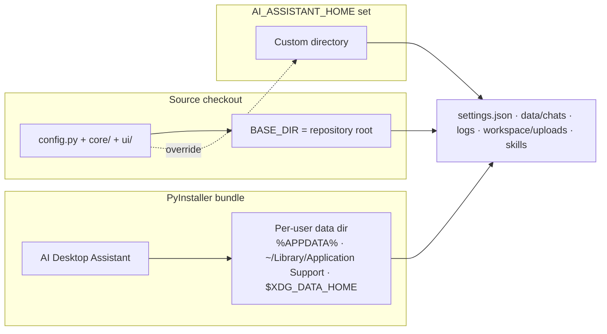

`config.py` creates `logs/`, `workspace/uploads/` and `skills/` on import;
`core.memory` creates `data/chats/`. On a relocated install, bundled example
skills are copied into the writable `skills/` directory once.

Release artifacts are built by `scripts/build.py` (PyInstaller onedir, archive,
`SHA256SUMS`) and `.github/workflows/release.yml` (wheel/sdist, CycloneDX SBOM,
Windows installer, macOS DMG, GitHub release, PyPI trusted publishing).
Chromium is not bundled; run `playwright install chromium` after installing.

---

## 13. Invariants worth preserving

1. **One registry.** Core tools, skill tools and MCP tools all register in
   `core.tools.REGISTRY`; providers never keep their own tool tables.
2. **Engine stays transport-free.** No OpenAI/Gemini/Anthropic types in
   `core/ai_engine.py`.
3. **Provider loops log consistently.** Use `BaseProvider.execute_tool()` and
   `report_tool_error()`, not `REGISTRY.call()` directly.
4. **Atomic memory writes.** `save_chat` goes through `.tmp` + `Path.replace()`
   under the module lock.
5. **Attachment pixels are derived.** Chats keep metadata; `load_model_image()`
   reads the downscaled copy from disk.
6. **MCP tools are ephemeral.** `_build_registry()` unregisters every `mcp__*`
   tool before re-registering the currently connected servers.
7. **Skills are opt-in.** Discovery never imports code; only `enabled_skills`
   with a valid manifest and `skill.py` are executed.
8. **GUI thread stays responsive.** Any blocking call belongs in a worker.

## Where to change what

| Change | Files |
|---|---|
| Add a core tool | Implement and register in `core/tools/<module>.py`; add its group in `config.TOOL_GROUPS`; `_build_registry()` already registers the module. |
| Add a provider type | One `ProviderSpec` in `core/providers/__init__.py` plus a `BaseProvider` subclass. |
| Change the system prompt | `SYSTEM_INSTRUCTION_TEMPLATE` in `core/ai_engine.py`. |
| Add a slash command | `ui/commands.py` and `MainWindow._process_slash_command()`. |
| Change theme tokens | `ui/theme.py` (tokens + the single global stylesheet). |
| Change attachment limits | `core/attachments.py`. |
| Change MCP timeouts | `config.DEFAULT_SETTINGS["mcp_call_timeout"]` and `core/mcp/manager.py` defaults. |
