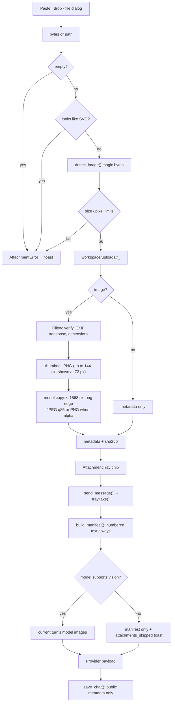

# Attachments

Images and files can be added in three ways:

- paste from the clipboard (**Ctrl+V**), which stores PNG bytes;
- drag & drop onto the composer;
- the clip button, which opens a file dialog.

The tray shows numbered chips (`#1`, `#2`, …). Images can be previewed by
clicking, reordered by dragging, and removed with **×**. Removing a chip deletes
its stored files; `take()` hands the list to the sender and keeps the files.

## Limits

| Limit | Value |
|---|---|
| Attachments per message | 10 |
| Image size | 20 MB |
| Other file size | 50 MB |
| Image pixels | 50 MP |
| Accepted raster formats | PNG, JPEG, GIF, WebP |
| Refused | SVG, animated GIF/WebP |

Type detection uses magic bytes, not the extension. SVG is refused even when it
is disguised as another type. An image that Pillow cannot verify, or that is
animated, is rejected with a user-readable message shown as a toast.

## Pipeline

Stored metadata includes `id`, `kind`, `name`, `path`, `mime`, `size`,
`width`/`height`, `sha256`, `index`, `thumb`, `model_path` and `model_mime`.
Original bytes are copied once; the model-ready derivative is regenerated from
disk with `load_model_image()`.

## Sending to providers

`core/providers/multimodal.py` builds the provider-specific payload:

| Provider | Image representation |
|---|---|
| OpenAI-compatible | `image_url` with a `data:<mime>;base64,...` URI |
| Anthropic | `image` content block with base64 source |
| Gemini | `types.Part.from_bytes(data, mime_type)` |

Images are sent in `index` order, each preceded by an `Image #n:` text label, so
"compare image 1 with image 2" is unambiguous. The current user message also
carries the numbered text manifest.

Only the **current turn's pixels** are sent. Older turns keep their manifest
text (rebuilt by `clean_history`), which limits tokens and cost. If the active
model has no vision capability, no pixels are sent at all; the manifest notes
that image content is not visible and the window shows an
`attachments_skipped` toast.

## Chat persistence

`save_chat()` stores `public_metadata()` only — never base64. Attachment files
live under `workspace/uploads/<chat_id>/` and are referenced by path. Switching
chats calls `clear_discard()` on the tray so unsent chips do not leak into the
next conversation.
