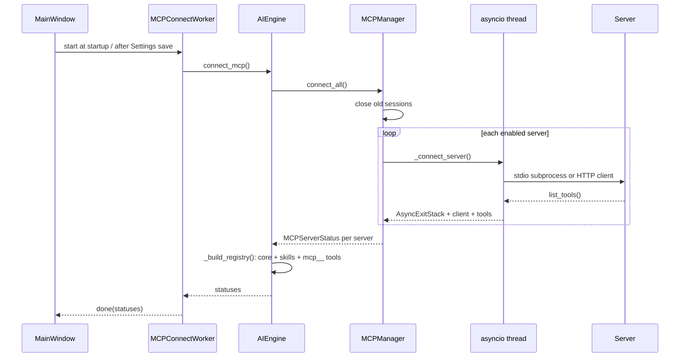
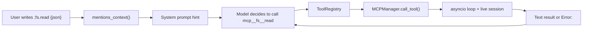

# MCP

The assistant is an MCP (Model Context Protocol) **client**. It connects to the
servers configured in `settings.json → mcp_servers`, exposes their tools to the
model, and keeps each session open for the lifetime of the app.

## Configuration

Open **Settings → MCP**. Each server has:

| Field | Notes |
|---|---|
| `id` | Stable identifier; used in the qualified tool name. Falls back to the label or `server_N`. |
| `label` | Human-readable name shown in the UI and in tool descriptions. |
| `transport` | `stdio` or `http`. Defaults to `stdio`. |
| `enabled` | Disabled servers are listed but never started. |
| `command`, `args`, `env` | `stdio` only. `env` is merged over the current process environment. |
| `url`, `headers` | `http` only. Headers are optional. |

```json
{
  "id": "filesystem",
  "label": "Filesystem",
  "transport": "stdio",
  "command": "npx",
  "args": ["-y", "@modelcontextprotocol/server-filesystem", "/tmp"],
  "env": {"TOKEN": "..."},
  "enabled": true
}
```

The dialog also sets **Tool call timeout** (`mcp_call_timeout`, 5–600 seconds,
default 60). Saving Settings reconnects every enabled server and rebuilds the
tool registry.

## Lifecycle



A failure is isolated: the broken server gets an error in its `MCPServerStatus`
and the app continues with the remaining servers. The first failure is shown as
a toast. `/mcp` prints every server's transport, state and tool count.

## Tool names and mentions

Tools are registered as:

```
mcp__<slug(server_id)>__<slug(tool_name)>
```

The model calls them like any other tool. The user can request one explicitly
in the composer:

- `;server.tool` — the popup lists tools of connected servers. With none
  connected it says "No hay servidores MCP configurados".
- `;fs.read {"path": "notes.md"}` — pass an exact JSON argument object.
- `;fs.read` without JSON — the model chooses the arguments from the prompt.

A mention adds a hint to the system prompt for that turn; it does **not** execute
the tool directly. The model still calls it through the normal tool channel.



MCP tools are **excluded from the `read-only` tool profile**. They are available
in `compact` and `full`.

## Timeouts and errors

- Connect timeout: `min(mcp_call_timeout, 15 s)`, plus a 5 s loop-stop margin.
- Call timeout: `mcp_call_timeout` (default 60 s), plus the same margin.
- Timeouts and exceptions become `Error: ...` strings the model can read; the
  app does not crash.
- Calls made from the manager's own event-loop thread are refused, preventing a
  deadlock.

## Installation

MCP support is the optional `mcp` extra:

```bash
uv sync --extra mcp
# or
pip install "mcp>=2.0"
```

The manager imports the SDK lazily. Without it, each server reports an
actionable "MCP support is not installed" error and the rest of the app keeps
working. HTTP servers with custom headers import `httpx2` and the
streamable-HTTP client; if either is missing, that server reports the
installation error and the others continue.
