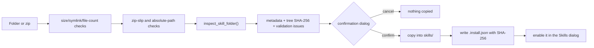

# Skills 2.0

A skill is a folder under `skills/` that packages instructions, reference
documents and — optionally — Python tools. Only skills listed in
`settings.json → enabled_skills` are active; copying a folder into `skills/`
does nothing until it is enabled in **Settings → Skills**.

## Layout

```
skills/<id>/
├── SKILL.md       # YAML frontmatter + instruction body (required)
├── skill.py       # optional: register(registry)
├── references/    # documents read on demand with read_skill_reference
└── scripts/       # optional; every file must be declared in frontmatter
```

The folder name is the skill id and must match `^[A-Za-z0-9][A-Za-z0-9_-]{0,63}$`.

## SKILL.md

```yaml
---
name: browser-helper
description: Guides the assistant to navigate and inspect web pages.
version: 1.0.0
tags: [browser, web]
allowed-tools: [browser_goto, browser_read_page]
read-only: false
scripts: [scripts/extract.py]
---
```

| Field | Required | Meaning |
|---|---|---|
| `name` | yes | Display name. |
| `description` | yes | What the skill is for. Write it in the third person ("Guides the assistant to …"); a first/second-person opening produces a warning. Keep it ≤ 1024 characters. |
| `version` | no | Informational version string, default `0.0.0`. |
| `tags` | no | Short labels shown in the catalog. |
| `allowed-tools` | no | Tools the skill may use. For a `read-only` skill these are also added to the `read-only` tool profile. |
| `read-only` | no | Marks the skill as inspection-only. |
| `scripts` | no | Script files the skill ships. Every file under `scripts/` must be declared (relative path or filename). |

The body is the instruction text. Keep it under **500 lines and about 5 000
tokens** (estimated as characters / 4); move detail to `references/` and load
it only when needed.

## Discovery and activation

Discovery (`core/skills_manager.discover_skills`) reads frontmatter only and
**never imports code**. For every folder it builds a `SkillInfo` with metadata,
validation issues, `enabled`, `legacy` and `has_code`.

- Every enabled skill contributes a compact catalog entry (id, description,
  tags) to the system prompt on every chat turn.
- The full body is loaded only when:
  - the user writes `@skill-id` (that turn only), or
  - the model calls `load_skill(name)`.
- `read_skill_reference(name, path)` reads a file inside that skill's
  `references/` folder.
- `skill.py` is imported only for enabled, **valid** skills that ship code. Its
  `register(registry)` function adds tools. Import failures print
  `[SkillsManager] Failed to load skill '<id>': …` to stdout and are skipped.

`load_skill` and `read_skill_reference` are registered only when at least one
skill is enabled. The catalog and `@` completion list also come from enabled
skills, so disabling a skill removes both its body and its tools.

## Validation

`validate_skill()` is static: it never executes the skill. It checks:

- `SKILL.md` exists and its YAML frontmatter is closed and parseable.
- `name` and `description` are present; the description is third-person and
  ≤ 1024 characters.
- Body ≤ 500 lines and ~5 000 tokens.
- Every `references/...` path mentioned in the body exists.
- No absolute paths (`/home`, `/usr`, `/tmp`, `C:\`, `~/`, …).
- Every file under `scripts/` is declared, and every declared script exists.
- No symlinks anywhere in the folder.
- `allowed-tools` entries are known tool names (warning when unknown).
- A `read-only` skill that ships `skill.py` but declares no `allowed-tools`
  gets a warning: its tools are not part of the read-only profile.

Run the same checks from the command line:

```bash
uv run python scripts/validate_skills.py
```

The Skills dialog shows the same issues as badges (`error` blocks enabling,
`warning` is informational).

## Installation

Skills can be installed from a folder or a `.zip` in **Settings → Skills**.
Nothing is copied without explicit confirmation.



Limits and guards:

- ≤ 10 MB total, ≤ 2 MB per file, ≤ 200 files (zip archives: ≤ 400 entries).
- No symlinks; no absolute paths, drive letters or backslashes in zip entries;
  zip-slip is rejected.
- The folder must contain `SKILL.md`, or legacy `skill.json` **and** `skill.py`.
- The confirmation summary includes name, description, allowed tools,
  read-only flag, whether it ships code, the SHA-256 and validation issues.
- The tree hash is stored in `.install.json`; re-installing replaces the folder.

## Legacy skills

A folder with `skill.json` but no `SKILL.md` still loads with a warning.
**Migrate legacy…** (`migrate_legacy_skill`) writes a `SKILL.md` from the old
manifest and renames the JSON to `skill.json.bak`. The old `skill.py` keeps
working.

## Writing a skill tool

`skill.py` receives the shared `ToolRegistry`:

```python
def register(registry):
    registry.register(
        name="get_word_count",
        description="Counts the words in a text.",
        parameters={
            "type": "object",
            "properties": {"text": {"type": "string"}},
            "required": ["text"],
        },
        func=lambda text: f"{len(text.split())} words",
    )
```

Tools registered this way are visible to every provider and are subject to the
same schema validation, result truncation and Dev Mode logging as core tools.
